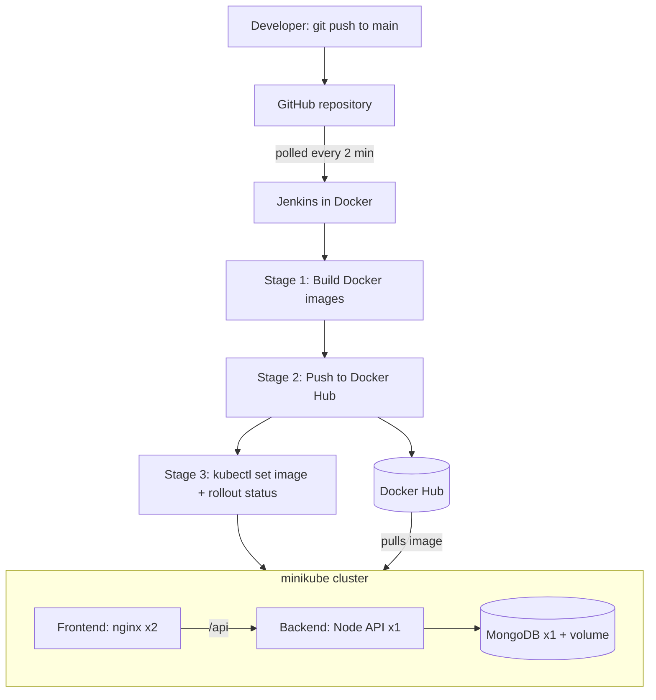

# Blushé: CI/CD pipeline to Kubernetes

A MERN e-commerce app (Blushé, a cosmetics store) deployed to a Kubernetes cluster through a fully automated Jenkins CI/CD pipeline. A single `git push` builds the Docker images, pushes them to Docker Hub, and rolls the new version out to Kubernetes with no manual steps.

## Architecture



## Tech stack

| Layer | Tools |
|---|---|
| Frontend | React, Vite, Tailwind CSS, served by nginx |
| Backend | Node.js, Express, Mongoose, JWT |
| Database | MongoDB (with a PersistentVolumeClaim) |
| Containers | Docker, multi-stage builds, Docker Hub |
| CI/CD | Jenkins (declarative pipeline, running in Docker) |
| Orchestration | Kubernetes (minikube), kubectl |

## Repository structure

```
blushe/
├── Backend/
│   ├── Dockerfile
│   ├── .dockerignore
│   └── server.js ...
├── Frontend/
│   ├── Dockerfile          # multi-stage: Vite build, then nginx
│   ├── nginx.conf          # serves the SPA and proxies /api to the backend
│   └── src/ ...
├── k8s/
│   ├── deployment.yaml     # frontend Deployment (2 replicas)
│   ├── service.yaml        # frontend Service (NodePort)
│   ├── backend.yaml        # backend Deployment + ClusterIP Service
│   └── mongo.yaml          # MongoDB Deployment + PVC + Service
├── Jenkinsfile             # the CI/CD pipeline
└── README.md
```

## How the pipeline works

The `Jenkinsfile` defines three stages:

1. **Build images:** builds `palaksh16/blushe-frontend` and `palaksh16/blushe-backend`, tagged with the Jenkins build number (for example `:7`), so every deploy is traceable.
2. **Push images:** logs in to Docker Hub with a stored access token and pushes both images. Each push retries up to 3 times to survive network drops.
3. **Deploy to Kubernetes:** runs `kubectl set image` on both Deployments and waits for `kubectl rollout status`. If a rollout fails, it runs `kubectl rollout undo` automatically.

Jenkins checks the repository for new commits every 2 minutes (Poll SCM), because the Jenkins server runs on a laptop that GitHub cannot reach with a webhook.

## Key design decisions

- **nginx as a reverse proxy.** The frontend is built with `VITE_API_URL=/api`, and nginx forwards `/api/*` to the `blushe-backend` Service. The browser only ever talks to one address, so there are no CORS problems and no hard-coded backend URLs.
- **Secrets stay out of Git.** The JWT secret is stored as a Kubernetes Secret and injected as environment variables. Registry and cluster credentials live in Jenkins credentials (`dockerhub-creds`, `kubeconfig`).
- **Two frontend replicas** keep the site available while a pod is being replaced during a rolling update.
- **MongoDB uses a PersistentVolumeClaim**, so data survives pod restarts.
- **Versioned image tags** (build number) instead of `latest` make rollbacks and audits simple.
- **Automatic rollback** if the new version does not become healthy within 3 minutes.

## Run it yourself

### Prerequisites

Docker Desktop, minikube, kubectl, and Git.

### 1. Start the cluster and deploy

```bash
minikube start --driver=docker

# Create the backend secret (use your own random value)
kubectl create secret generic blushe-backend-secret \
  --from-literal=JWT_SECRET=<your-random-secret> \
  --from-literal=JWT_EXPIRE=7d

kubectl apply -f k8s/
kubectl get pods

# Load sample products
kubectl exec deployment/blushe-backend -- node seed.js

# Open the site (keep this terminal open)
minikube service blushe-frontend --url
```

### 2. Start Jenkins

```bash
docker run -d --name jenkins -p 8081:8080 \
  -v jenkins_home:/var/jenkins_home \
  -v /var/run/docker.sock:/var/run/docker.sock \
  --user root jenkins/jenkins:lts-jdk17

# Install the Docker CLI and kubectl inside the Jenkins container
docker exec -u root jenkins bash -c "apt-get update && apt-get install -y docker.io curl"
docker exec -u root jenkins bash -c "curl -LO https://dl.k8s.io/release/v1.36.0/bin/linux/amd64/kubectl && install kubectl /usr/local/bin/kubectl"

# Let Jenkins reach minikube
docker network connect minikube jenkins
```

Create a kubeconfig for Jenkins that points to minikube's internal address (`https://192.168.49.2:8443`).

### 3. Configure Jenkins

Add these under **Manage Jenkins, Credentials, System, Global**:

| ID | Type | Contents |
|---|---|---|
| `dockerhub-creds` | Username with password | Docker Hub username and an access token |
| `kubeconfig` | Secret file | The kubeconfig for minikube |

Then create a **Pipeline** job with *Pipeline script from SCM*, this repository, branch `*/main`, script path `Jenkinsfile`, and *Poll SCM* set to `H/2 * * * *`.

### 4. Trigger a deployment

Change any text in the frontend and commit it to `main`. Within about two minutes Jenkins builds, pushes, and deploys the new version. Check it with:

```bash
kubectl get pods
kubectl describe deployment blushe-frontend | grep Image
```

## Demo

- Demo video: *add link here*
- Screenshots are in the `docs/` folder:
  - Jenkins pipeline with all stages green
  - Jenkins console output ending in `Finished: SUCCESS`
  - `kubectl get pods` and `kubectl get deployments`
  - Docker Hub repositories with build-number tags
  - The running website

## Problems solved along the way

| Problem | Fix |
|---|---|
| Jenkins in a container could not reach minikube at `127.0.0.1` | Connected Jenkins to the `minikube` Docker network and pointed the kubeconfig at the cluster's internal IP |
| Pipeline could not find credentials | Credentials must be created in the System, Global store with exact IDs, not in a user's personal store |
| Docker Hub timeouts and `EOF` errors during push | Added DNS servers to the Docker engine and wrapped build and push steps in `retry(3)` |
| A failed early stage triggered a rollback of the running site | Moved rollback logic into the deploy stage so it only runs when the rollout itself fails |
| Hard-coded `localhost:5000` API URL in the frontend | Built the image with `VITE_API_URL=/api` and added an nginx `/api` proxy |

## Future improvements

- Replace `kubectl set image` with **Argo CD** (GitOps): Jenkins handles CI, Argo CD handles CD
- Add an **Ingress** controller instead of NodePort
- Package the manifests as a **Helm** chart
- Add unit tests and an image vulnerability scan (for example Trivy) as extra pipeline stages
- Add **Prometheus and Grafana** monitoring to the cluster
- Use a GitHub webhook instead of polling when Jenkins runs on a public server

## Author

Palak, [github.com/Palak-builds](https://github.com/Palak-builds)
